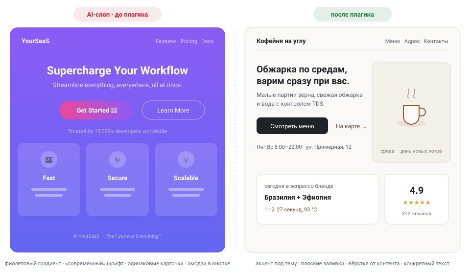
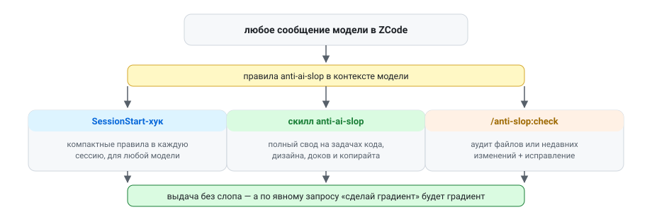

# Anti AI Slop


<p align="center">
  
</p>

Плагин для ZCode, который отучает любые модели от «AI-слопа» — фирменных признаков
нейросетевого кода и дизайна. Нейросети рисуют один и тот же лендинг: фиолетовый градиент,
шрифт Inter, три одинаковые карточки, 🚀 в кнопке — и пишут код с комментами-пересказом
и `try/catch`, который не может сработать. Этот плагин ставит на всё это запрет по умолчанию.

## Как это устроено

<p align="center">
  
</p>

Три канала доставки правил, перекрывающие друг друга:

- **SessionStart-хук** — при старте каждой сессии вливает компактную версию правил в контекст.
  Работает для любой модели в ZCode, до первого сообщения, без ручного вызова.
- **Скилл `anti-ai-slop`** — поднимается на задачах кода, дизайна, доков и копирайта и разворачивает
  полный свод: 40+ конкретных запретов с заменами вместо абстрактного «пиши красиво».
- **Команда `/anti-slop:check`** — точечный аудит заданных файлов или недавних изменений:
  находит слоп, показывает где и предлагает исправления.

### На чём основаны правила

Каждый пункт свода выведен из публичных разборов того, по чему ИИ-работу узнают на практике:

- **Дизайн** — анализ повторяющихся паттернов AI-генераторов интерфейсов: фиолетовые градиенты,
  Inter, равные карточные сетки, шаблонный hero+pricing ([3 UI Slop Patterns](https://dev.to/kenimo49/3-ui-slop-patterns-in-ai-ui-generators-purple-gradients-inter-fonts-uniform-cards-11l6),
  [Why Your AI-Generated UI Looks Like Everyone Else's](https://medium.com/@Rythmuxdesigner/why-your-ai-generated-ui-looks-like-everyone-elses-and-how-to-break-the-pattern-7a3bf6b070be)).
- **Код** — признаки сгенерированного кода в ревью: пересказ очевидного комментами, защитный
  бойлерплейд вокруг невозможных ошибок, игнорирование стиля проекта ([Pangram: AI Code Detector](https://www.pangram.com/blog/ai-code-detector),
  [How to Check if Code Is AI Generated](https://aitools.sh/blog/how-to-check-if-code-is-ai-generated)).
- **Словарь** — списки слов-маркеров LLM-текста, собранные по частотности ([Wikipedia: Signs of AI writing](https://en.wikipedia.org/wiki/Wikipedia:Signs_of_AI_writing),
  [Most Common ChatGPT Words to Avoid](https://walterwrites.ai/most-common-chatgpt-words-to-avoid)).
- **Дизайн-фингерпринт 2025–26** — дефолтный Tailwind `blue-500`/`indigo-600` и нетронутый
  shadcn/ui как главный маркер vibe-coded сайтов ([Why designers should care about Tailwind and ShadCN](https://annaarteeva.medium.com/why-designers-should-care-about-tailwind-and-shadcn-especially-in-the-ai-era-55b744c42603),
  [Design Tips for your Vibe Coded Project](https://blog.differ.design)).
- **Структура текста** — устойчивые маркеры переехали из слов в конструкцию: принудительное
  «правило трёх», связки «not X, but Y», сиркофания, гладкий ритм без фрагментов. Из недавних
  разборов (The Economist «How to spot AI writing»; Guardian про em-dash): одиночный маркер —
  не доказательство, оценивать надо структуру целиком.
- **Код-2026** — generic verb-sludge имена (`handleClick`, `processData`), мусорные utils-модули,
  мёртвые импорты, тавтологические тесты ([How to Detect AI Generated Code in 2026](https://www.zylocode.com/blog/how-to-detect-ai-generated-code-2026)).

Свод проверен на живой задаче — лендинг, собранный с активным плагином, вышел без градиентов,
Inter и эмодзи, с вёрсткой от контента.

> **Явный запрос снимает запрет**: «сделай фиолетовый градиент» — будет градиент, без нытья.
> «Сделай красиво» и «современно» — ничто не снимают.

---

## Что запрещено по умолчанию

### Дизайн и UI

| Запрещено | Вместо |
|---|---|
| фиолетово-синие градиенты (`#8B5CF6`, `#7C3AED`, `#6366F1`), неон, `bg-clip-text` | один сдержанный акцент под тему, плоские заливки |
| шрифт Inter как «выбор» | шрифт проекта или характерный для темы |
| эмодзи в UI, кнопках, заголовках, консоли | текст; эмодзи только по явному запросу |
| глассморфизм и `backdrop-blur` на каждом углу | плотные поверхности, 1px рамки, честные тени |
| одинаковые карточные сетки, `rounded-2xl` на всём | живая сетка: акценты, списки, таблицы, асимметрия |
| шаблонный лендинг hero + 3 карточки + pricing | вёрстка от контента и предмета |
| копирайт «Streamline your workflow», «Supercharge…» | конкретика: что продукт реально делает |
| дефолтный Tailwind `blue-500`/`indigo-600` как основной, нетронутый shadcn | палитра под предмет или токены проекта |
| градиентные «шары» и блобы в фоне, шумовые оверлеи | чистый фон или настоящая графика |
| фейковые отзывы со стоковыми именами и кружками-аватарами | реальные цитаты или никакие |
| `hover:scale-105` на каждой карточке, суп из отступов | движение со смыслом; единый spacing scale |

### Код

| Запрещено | Вместо |
|---|---|
| комменты-пересказ (`# инкремент`, «This function…», баннеры) | коммент только для неочевидного *why* |
| `try/catch`, который не может сработать; null-чеки невозможных null | обработка реальных ошибок в идиоме проекта |
| непрошеные фичи, фреймворки, абстракции «на будущее» | минимальное корректное изменение |
| регенерация всего файла | точечные правки соседнего кода не трогаются |
| собственный стиль вопреки проекту | сначала прочитать окружающий код и повторить его |
| `handleClick`, `processData`, мусорные `utils`-модули | имена от предметной области |
| мёртвые импорты, TODO-заглушки «implement later» | в код попадает только работающее |
| тавтологические тесты, `assert True` после вызова | тест реального поведения или никакого |
| широкий `except Exception` в одноразовом скрипте | обработка того, что реально падает |

### Разговор

| Запрещено | Вместо |
|---|---|
| «Отличный вопрос!», «You're absolutely right!» | сразу ответ |
| пересказ запроса перед ответом | ответ |
| «Надеюсь, это помогло!», «In summary…», recap | конец там, где кончился ответ |
| принудительное «правило трёх», «not X, but Y» | столько пунктов, сколько существует |
| сиркофания и стопки оговорок | одна честная оговорка там, где важна |
| bullet-спам и болд на каждой строке | проза для коротких ответов, списки для списков |

### Словарь

`robust`, `seamless`, `comprehensive`, `leverage`, `delve`, `tapestry`, `testament`,
`harness`, `unlock`, `elevate`, `pivotal`, `game-changer`, «it's worth noting» — не
использовать. Писать plainly: что код делает и при каких условиях работает. «Robust» →
«ретраит 3 раза, потом падает громко».

---

## Установка (ZCode Desktop)

1. **Plugin Marketplace → Add → Add Plugin Marketplace**
2. Вставь адрес репозитория: `https://github.com/artnovaafk/anti-ai-slop`
3. Установи плагин **Anti AI Slop** из появившегося маркета.

Проверка: открой новый чат и попроси лендинг для кофейни — в результате не должно быть
фиолетовых градиентов, Inter и эмодзи в UI.

<details>
<summary><strong>Если хост не ZCode</strong></summary>

- **Скилл**: скопируй `anti-ai-slop/skills/anti-ai-slop` в `~/.claude/skills/` или общий
  `~/.agents/skills/`.
- **Всегда-на правила**: содержимое `anti-ai-slop/hooks/rules/always.md` вставь в свой
  AGENTS.md / CLAUDE.md / системный промпт — хук `${CLAUDE_PLUGIN_ROOT}` сработает только
  внутри плагинного механизма.

</details>

<details>
<summary><strong>Состав репозитория</strong></summary>

```
marketplace.json                                — каталог: установка по URL репозитория
anti-ai-slop/.zcode-plugin/plugin.json          — манифест плагина
anti-ai-slop/skills/anti-ai-slop/SKILL.md       — полный свод правил
anti-ai-slop/hooks/hooks.json                   — SessionStart-хук
anti-ai-slop/hooks/rules/always.md              — компактные правила для каждой сессии
anti-ai-slop/commands/check.md                  — команда /anti-slop:check
```

</details>

## Как править

Редактируй `anti-ai-slop/skills/anti-ai-slop/SKILL.md` (полный свод) и
`anti-ai-slop/hooks/rules/always.md` (компактная версия). После правок подними `version`
в манифесте и в `marketplace.json`, закоммить — обновление придёт тем, кто добавил репо
как маркетплейс.

---

## English summary

A ZCode plugin that stops AI models from producing tell-tale "AI slop": purple/neon gradients,
the Inter font, emoji UI, glassmorphism, uniform card grids, Tailwind blue-500/shadcn defaults,
fake testimonials, AI vocabulary (*robust*, *seamless*, *delve*, *leverage*…), over-commenting
and defensive boilerplate — plus the behavioral tells: sycophancy openers, restated requests,
performative endings, forced tricolons and bullet-spam. The ruleset is grounded in public
analyses of AI-detectable patterns (see the Russian section for sources). A SessionStart hook
injects compact rules into every session; the `anti-ai-slop` skill carries the full rulebook;
`/anti-slop:check` audits files and fixes findings. Each ban is lifted only when the user
explicitly asks for that exact pattern. Install: Plugin Marketplace → Add → paste this
repository URL.
